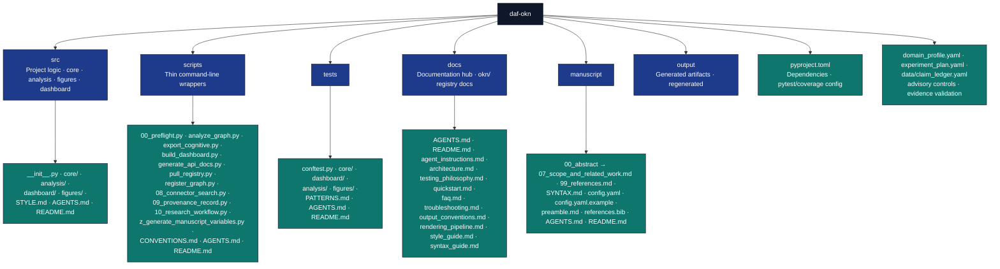

# DAF-OKN — Open Knowledge Network Pull, Analyze, Visualize, Contribute

`daf-okn` is an active project for the Open Knowledge Network (OKN): pulling
registry data from [okn.us](https://okn.us/) / [registry.okn.us](https://registry.okn.us/),
analyzing and visualizing knowledge graphs, and contributing back — including
exporting the Active Inference Institute `cognitive` knowledge graph to the
registry.

The research experiment is "graph-analysis": pull the OKN registry catalog
(45 graphs), export a knowledge base (cognitive vault case study) to a typed
graph, measure structure, visualize, and package a validated registry
contribution.

Decision memory and verifier hardening: use nearby `WHY:` comments only for
surprising local choices, keep volatile counts generated, and add negative
controls for verifier-like gates.

## Module map (`src/daf_okn/`)

| Module | Purpose | Entry command |
| --- | --- | --- |
| `core/graph.py` | `GraphDocument` model: `NodeRecord`/`EdgeRecord`, `save_json`/`load_json`, `to_networkx`, `bindings_to_graph` (SPARQL JSON → graph) | — |
| `core/registry.py` | `OKNRegistry`: list/get graphs over `kgs.yaml`, per-graph/federation SPARQL, TPF fragments, VoID endpoints, embeddings; `RegistryError` on HTTP ≥ 400; no I/O at import; injected `requests.Session` | `scripts/pull_registry.py` |
| `core/invariants.py` | `validate_graph` (empty/duplicate ids, dangling endpoints, self-loops) and `graph_stats` | — |
| `core/cognitive_adapter.py` | Obsidian-vault parser: `parse_frontmatter`, wiki links, semantic relations, `build_cognitive_graph`, `export_cognitive_kb` | `scripts/export_cognitive.py` |
| `core/rdf.py` | `graph_to_rdf` / `build_rdf_graph`: RDF with SKOS/DCTERMS/schema.org terms; entity IRIs under `https://purl.org/okn/frink/kg/<shortname>/`, named graph `https://purl.org/okn/frink/kg/<shortname>`; custom relations become `<base>relation/<name>` sub-properties of `skos:semanticRelation`; other attributes under `<base>vocab/`; sorted, byte-stable N-Triples/N-Quads | `daf-okn package` |
| `cli.py` | `daf-okn` / `python -m daf_okn`: `pull`, `export`, `analyze`, `visualize`, `package` | `daf-okn --help` |
| `core/contribute.py` | `registry_entry` (frontmatter limited to the registry's documented fields; never `sparql`/`tpf`), `contribution_checklist`, `upload_commands`, `validate_package` (writes `<shortname>.<fmt>`, `registry/docs/registry/kgs/<shortname>.md`, `checklist.md`), `PRESET_ENTRIES`, `register_graph` CLI | `scripts/register_graph.py` |
| `core/manuscript_variables.py` | `generate_variables(config_path, require_analysis_outputs=True)` → flat `{{TOKEN}}` map from `manuscript/config.yaml` + `output/data/graph_report.json`; `--allow-draft` → `"N/A"` sentinels | `scripts/z_generate_manuscript_variables.py` |
| `core/documentation.py` | `build_api_reference_markdown()` — introspection over the real modules; no static template | `scripts/generate_api_docs.py` |
| `core/project_paths.py` | `resolve_project_root`, `project_root_context`, `project_output_dirs` | — |
| `core/_runtime.py` | `get_logger`, `save_figure_data` | — |
| `analysis/graph_metrics.py` | `compute_metrics`: node/edge counts, density, connectivity, mean degree, triangles, degree/betweenness centrality, top central nodes; helpers for degree sequences and edge scores | — |
| `analysis/pipeline.py` | `run_analysis(graph, out_dir)` → `graph_report.json` (`REPORT_FILENAME`); `FileNotFoundError` in pipeline mode when the report is missing | `scripts/analyze_graph.py` |
| `figures/network_figure.py` | `plot_network` (spring/circular/kamada_kawai/random), `network_figure_bytes`, `plot_graph_catalog` | used by `scripts/10_research_workflow.py` |
| `dashboard/` | `build_dashboard_html` (static HTML from graph + metrics payload), `cli_main` | `scripts/build_dashboard.py` |

## Command line

The `daf-okn` console script (also `python -m daf_okn`) exposes the pipeline as
subcommands: `pull` (`list`, `save-snapshot`, `query`), `analyze`, `export`,
`package`, and `visualize`. `package` writes the registry entry to
`<out>/registry/docs/registry/kgs/<shortname>.md`. The scripts under
`scripts/` remain thin wrappers over the same `src/daf_okn` functions.

## Layer rules

| Surface | Rule |
| --- | --- |
| `src/daf_okn/` | All logic: `core/` (graph model, registry client, invariants, adapters, RDF packaging), `analysis/`, `figures/`, `dashboard/` |
| `scripts/` | Thin command-line wrappers over `src/`; no logic lives only here |
| `tests/` | Direct tests of importable behavior; real data, no mocks |
| Live counts | Do not hardcode measured test totals or coverage % in docs; report live values |

## Installation/Setup

Install dependencies from this directory with `uv sync` (or
`pip install -e '.[dev]'`). [`pyproject.toml`](pyproject.toml) declares the
dependencies and the pytest/coverage settings.

## Protocol for AI Agents

**Critical Directive**: Before modifying this project, AI agents *must*
reference the specific behavioral rules laid out in the `docs/` folder:

- Start with `docs/agent_instructions.md` to understand operational constraints.
- Consult `docs/testing_philosophy.md` before writing or modifying any `pytest` files.
- Consult `docs/architecture.md` before altering `scripts/` or `src/` modular boundaries.

## Testing

```bash
# Run project tests
uv run pytest tests/ -v

# With coverage
uv run pytest tests/ --cov=src --cov-report=html

# Coverage gate
uv run pytest tests/ --cov=src --cov-fail-under=90
```

## Configuration

Configuration lives in `pyproject.toml`, `manuscript/config.yaml` (paper
metadata read by `core/manuscript_variables.py`), and environment variables. Advisory agentic-research controls
are declarative: `domain_profile.yaml` declares review gates, source policy,
artifact expectations, and benchmark rubric preferences;
`experiment_plan.yaml` declares experiment conditions, primary metric
(registry coverage, direction: maximize), expected figures/tables, and
ablations; `data/claim_ledger.yaml` registers sourced numeric claims for
evidence-registry validation. These overlays are validation inputs only; they
do not execute autonomous agents.

## Directory Structure



## Troubleshooting

### Common Issues

- **Import Errors**: Ensure the project is run from the project root directory
- **Missing Dependencies**: Run `uv sync` to install dependencies
- **`RegistryError`**: HTTP ≥ 400 or malformed responses from OKN endpoints —
  check network access and `kgs.yaml`; see `docs/troubleshooting.md`
- **`FileNotFoundError` on `graph_report.json`**: run `scripts/analyze_graph.py`
  (or `scripts/10_research_workflow.py`) before variable hydration, or pass
  `--allow-draft`

### Known Issues / Learnings

1. **`project_root` must be module-level**: define
   `project_root = Path(__file__).resolve().parent.parent` at module scope in
   orchestrator scripts, not inside `if __name__ == "__main__":`. Prefer
   `src/daf_okn/core/project_paths.py::resolve_project_root` for reusable
   resolution.

2. **`conftest.py` is required**: Without `tests/conftest.py` adding `src/` to
   `sys.path`, pytest cannot import project modules. This is not optional.

3. **`MPLBACKEND=Agg` in conftest**: Without this, matplotlib tests may try to
   open display windows and hang. Set
   `os.environ.setdefault("MPLBACKEND", "Agg")` at the top of `conftest.py`.

## Standards Compliance

### Testing standards

- **90%+ coverage**: the coverage gate on `src/` is enforced via
  `pyproject.toml` (`fail_under = 90`, branch coverage)
- **Real data only**: All tests use computations, no mocks
- **Full integration**: Tests cover module behavior end to end
- **Deterministic results**: Tests use fixed inputs; any use of random draws
  should be justified or seeded (see `docs/agent_instructions.md`)

### Documentation standards

- **AGENTS.md + README.md**: Complete technical documentation in each directory
- **Type hints**: All public APIs have type annotations
- **Docstrings**: Comprehensive docstrings with examples for all functions
- **Cross-references**: Links between related documentation sections

### Type Hints standards

- **Full annotations**: All public functions have type hints
- **Generic types**: Uses `List`, `Dict`, `Optional`, `Callable` appropriately
- **Consistent patterns**: Follows project conventions throughout

### Error Handling standards

- **Custom exceptions**: `RegistryError` for registry HTTP/malformed failures;
  typed errors for missing analysis outputs
- **Context preservation**: Exception chaining with `from` keyword
- **Informative messages**: Clear error messages with actionable guidance

### Logging standards

- **Unified logging**: `get_logger(__name__)` from `src/daf_okn/core/_runtime.py`
- **Appropriate levels**: DEBUG, INFO, WARNING, ERROR as appropriate
- **Context-rich messages**: Includes relevant context in log messages

### Code Style standards

- **Ruff formatting** (`uv run ruff format`): 88-character line length (default
  alignment), consistent formatting — mirrors CI
- **Descriptive names**: Clear variable and function names
- **Import organization**: Standard library, third-party, local imports
  properly organized

### Compliance Verification

```bash
# Test coverage verification
uv run pytest tests/ --cov=src --cov-fail-under=90

# Type hint verification (same project source surface used by CI)
uv run mypy -p daf_okn

# Documentation completeness check
find . -name "*.py" -exec grep -L '"""' {} \;
```

## Agent Skill Examples

### Query the registry

```python
from daf_okn.core.registry import OKNRegistry

registry = OKNRegistry()          # reads kgs.yaml; inject requests.Session in tests
for entry in registry.list_graphs():
    print(entry["shortname"], entry.get("title"))

rows = registry.sparql_rows("cognitive", "SELECT ?s ?p ?o WHERE { ?s ?p ?o } LIMIT 10")
```

### Analyze a graph

```python
from daf_okn.core.graph import load_json
from daf_okn.analysis.pipeline import run_analysis

graph = load_json("output/data/cognitive_kg.json")
report = run_analysis(graph, out_dir="output/analysis")   # writes graph_report.json
print(report["metrics"]["node_count"], report["metrics"]["density"])
```

## Agent skill

A Hermes/agentskills.io-compatible skill for this project lives at
[`.agents/skills/daf-okn/SKILL.md`](.agents/skills/daf-okn/SKILL.md).
Load it when working inside this project to get when-to-use guidance,
quick reference commands, and pitfalls.

## Best Practices

- Validate graph invariants (`core/invariants.py`) before writing derived
  artifacts
- Keep network access at the edges: `OKNRegistry` performs I/O on request,
  never at import
- Keep `core/` free of script-level concerns; scripts stay thin wrappers over `src/`
- Document parameter choices in the manuscript

## See Also

- [`manuscript/SYNTAX.md`](manuscript/SYNTAX.md) — Pandoc
  citation/cross-reference syntax for this project
- [`README.md`](README.md) — project overview
- OKN: <https://okn.us/> · Registry: <https://registry.okn.us/>

## Stack onboarding gate

`bash scripts/gate.sh` is the offline stack gate. It uses `uv.lock` and the
development dependencies, propagates pytest failures, and enforces the existing
90% branch coverage threshold. It accepts no test-selection overrides.
