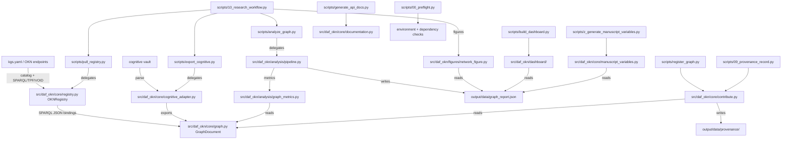

# Architecture: The Thin Orchestrator Flow

The offline development profile is the declared `dev` extra. The `build`
dependency group locks the declared setuptools backend for wheel builds with
`uv build --wheel --no-build-isolation`.

Canonical RDF capture/replay lives in `src/daf_okn/analysis/cross_graph.py`;
byte-preserving submission packaging and verification live in
`src/daf_okn/core/rdf_submission.py`. Their command parsing is in
`src/daf_okn/cli.py` (`join`, `bundle-rdf`). These methods consume cognitive's
canonical artifacts rather than importing its exporter or duplicating its graph.

The `daf_okn` project is designed around a strict separation of concerns across three layers. Understanding this architecture before modifying any file prevents the most common errors: project logic appearing in scripts, reusable graph behavior remaining trapped in CLI files, and mocks appearing in tests.

## Layer Reference

| Layer | Primary Files | Public API | Invariants | Testability |
|---|---|---|---|---|
| **`src/` — Project Logic** | `src/daf_okn/core/` (graph, registry, invariants, cognitive_adapter, contribute, manuscript_variables, documentation, project_paths, _runtime), `src/daf_okn/analysis/` (graph_metrics, pipeline), `src/daf_okn/figures/network_figure.py`, `src/daf_okn/dashboard/` | Graph model, `OKNRegistry`, validators, export/contribute builders, `compute_metrics`, `run_analysis`, figure builders, dashboard HTML | `core/` stays pure; no I/O at import in `core/registry.py` | Direct unit tests for pure logic; integration tests for generated artifacts |
| **`scripts/` — Orchestrators** | `scripts/00_preflight.py`, `analyze_graph.py`, `export_cognitive.py`, `build_dashboard.py`, `generate_api_docs.py`, `pull_registry.py`, `register_graph.py`, `08_connector_search.py`, `09_provenance_record.py`, `10_research_workflow.py`, `z_generate_manuscript_variables.py` | CLI entry points chaining `src/` behavior into `output/` artifacts | No experiment, plotting, dashboard, or manuscript-variable logic lives only in scripts; each script depends only on `src/daf_okn` and declared dependencies | Subprocess/integration tests exercise real commands |

## Strict Dependency Direction

```
scripts/ ──→ src/            (imports and calls project behavior)
src/daf_okn/core/ ──→ [stdlib + requests + networkx + rdflib + pyyaml only]
src/daf_okn/analysis/ ──→ core/
tests/   ──→ src/            (direct testing of importable project behavior)
tests/   ──→ scripts/        (CLI smoke tests)
```

No arrows go upward. Core project logic stays independent; `analysis/`, `figures/`, and `dashboard/` are the importable implementation behind the thin script wrappers.

Contribution packaging applies `GraphDocument.validate()` before reporting its
verdict, so dangling endpoints, duplicate or empty node IDs, and self-loops
cannot produce a successful `daf-okn package` exit. Diagnostic draft artifacts
remain available for structurally invalid graphs. Invalid shortnames and
resolved graph/registry/checklist destinations outside the requested output
directory prevent all package writes, including when an existing destination
symlink points outside that directory. Graph, registry entry and checklist
must refer to distinct physical files; symlink and hardlink collisions refuse
all writes. Both the direct validator and CLI have
real-file passing and failing controls under `tests/core/test_contribute.py`
and `tests/cli/test_cli.py`.



## Forbidden Patterns

| Pattern | Why It Is Forbidden | Correct Alternative |
|---|---|---|
| Graph/metric logic inside `scripts/` | Cannot be unit-tested without running the full script | Move to `src/`, add a test beside the existing suite |
| Network I/O at import time in `core/` | Makes every import environment-dependent | Keep `OKNRegistry` I/O on method calls; inject `requests.Session` in tests |
| Hardcoded absolute output paths in pure core modules | Makes copied projects brittle | Keep paths relative to the project root (`core/project_paths.py`) and isolated to analysis/dashboard/manuscript-variable modules |
| `unittest.mock`, `MagicMock`, `@patch` in `tests/` | Zero-mock policy | Compute real results with real `GraphDocument` fixtures |
| Hand-edited `output/` files | Overwritten on the next pipeline run | Change the generator in `src/`, then re-run the producing script |

## How to Add a New Capability

Follow these five steps in order:

1. **Add the function to the relevant `src/daf_okn/core/` module** — Pure logic only; no top-level I/O; add type hints and a Google-style docstring; export from `__init__.py`.

2. **Write a test class in `tests/core/`** — Follow the zero-mock pattern; use fixed `GraphDocument` fixtures; assert structural properties; run `uv run pytest tests/ --cov=src --cov-fail-under=90`.

3. **Wire orchestration in `src/daf_okn/analysis/`** — Import the new function from `core/`; run it inside `run_analysis()` or a sibling pipeline function; write results to `output/data/` or `output/figures/`.

4. **Update output conventions** — Document the new output file in `docs/output_conventions.md`; generated `output/` files stay untracked.

5. **Update manuscript section** — Edit the relevant `manuscript/` section with the description using concrete file paths (e.g., `src/daf_okn/analysis/graph_metrics.py::compute_metrics()`); add any result variables to `src/daf_okn/core/manuscript_variables.py::generate_variables()`; reference figures with `[@fig:label]` (Pandoc-crossref — see `docs/syntax_guide.md`).
