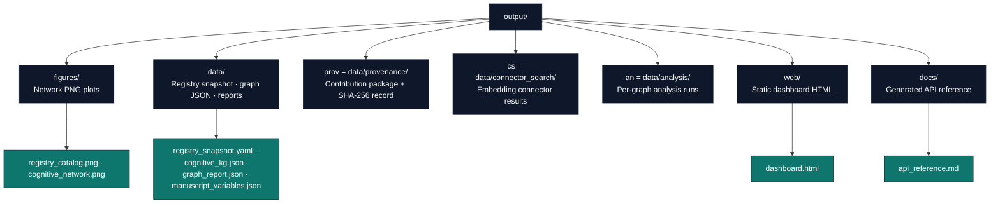

# Output Directory Conventions

The project-relative `output/` directory holds all generated artifacts from the analysis workflow. This document describes its structure, regeneration process, and version-control policy.

## Directory Purpose

`output/` is **disposable but regeneratable**. Every file in this directory is produced by a deterministic script; none should be edited manually. If any file is missing or corrupted, re-run the appropriate stage to recreate it.

**Key principle:** The source of truth for all outputs is the combination of:
- `src/daf_okn/analysis/pipeline.py` (graph analysis → `graph_report.json`)
- `manuscript/config.yaml` (experiment parameters)
- `scripts/10_research_workflow.py` (registry → export → analysis → figures)
- `scripts/z_generate_manuscript_variables.py` (manuscript variable map)

## Directory Structure



## Artifact Map

`daf-okn join` writes a fresh capture directory with raw queries, SPARQL responses,
hash manifest and linked join results. `--replay` verifies and reuses those inputs
offline. `daf-okn bundle-rdf` writes canonical RDF, graph documentation, registry
files and `bundle.json`; `--check` validates the actual directory. Use a fresh
output directory for each capture or bundle, preserving failures and earlier evidence.

| Artifact | Producer | Consumer |
|---|---|---|
| `output/data/registry_snapshot.yaml` | `scripts/pull_registry.py` / `10_research_workflow.py` stage 1 | coverage measurement, downstream stages |
| `output/data/cognitive_kg.json` | `scripts/export_cognitive.py` (stage 2) | analysis, dashboard, contribute |
| `output/data/graph_report.json` | `scripts/analyze_graph.py` / `run_analysis()` (stage 3) | manuscript variables, dashboard, claim ledger |
| `output/figures/registry_catalog.png`, `output/figures/cognitive_network.png` | stage 4 figures (`figures/network_figure.py`) | manuscript |
| `output/data/connector_search/results.json` | `scripts/08_connector_search.py` | connector review |
| `output/data/provenance/{package/,registry/,checklist.md,provenance_record.json}` | `scripts/09_provenance_record.py` (via `core/contribute.py`) | registry submission |
| `output/data/manuscript_variables.json` | `scripts/z_generate_manuscript_variables.py` | token substitution, debugging |
| `output/manuscript/*.md` | `scripts/z_generate_manuscript_variables.py` | your Markdown/Pandoc rendering step |
| `output/web/dashboard.html` | `scripts/build_dashboard.py` (via `dashboard/`) | human review |
| `output/docs/api_reference.md` | `scripts/generate_api_docs.py` (via `core/documentation.py`) | agent reference |

`graph_report.json` distinguishes source records and distinct statements from
the simple projection used for connectivity and density. See
[RDF identity and structural measurement](okn/graph-methods.md) for the counting
contract and the lossless multigraph interface.

## Regeneration Sequence

If any artifact becomes corrupted or you change the analysis, follow this sequence:

1. **Preserve evidence**: Use a fresh output destination for a new capture or
   submission bundle. Retain source-bound captures, validation receipts, failed
   runs and historical bundles until their replacements are verified. Regenerate
   routine derived artifacts through their producer rather than editing them.

2. **Run the research workflow** — registry snapshot, cognitive export, graph analysis, figures.
   ```bash
   uv run python scripts/10_research_workflow.py --cognitive-repo <vault>
   ```
   **Outputs**: `data/registry_snapshot.yaml`, `data/cognitive_kg.json`, `data/graph_report.json`, `figures/`
   (Stages 2–3 are skipped by design when no cognitive repo/graph is configured.)

3. **Package the contribution** — validated N-Quads, registry entry, checklist, SHA-256 record.
   ```bash
   uv run python scripts/09_provenance_record.py --graph output/data/cognitive_kg.json
   ```
   **Outputs**: `data/provenance/`

4. **Generate manuscript variables** — computes the `{{VARIABLE}}` token map (strict: requires `graph_report.json` unless `--allow-draft`).
   ```bash
   uv run python scripts/z_generate_manuscript_variables.py
   ```
   **Outputs**: `output/data/manuscript_variables.json`

5. **Build the dashboard** — static HTML from the graph + metrics payload.
   ```bash
   uv run python scripts/build_dashboard.py --graph output/data/cognitive_kg.json
   ```
   **Outputs**: `web/dashboard.html`

6. **Render (outside this repository)** — produce PDF/HTML from the resolved chapters in `output/manuscript/` with your own Markdown/Pandoc toolchain (see [`rendering_pipeline.md`](rendering_pipeline.md)).

## Version-Control Policy

- **Do not edit files in `output/` manually** — changes will be overwritten on the next pipeline run.

- **When adding a new output file** (e.g., a new figure or data product):
  1. Give it a fixed, predictable filename and a documented producer.
  2. Wire the producing script.
  3. Add a regeneration step to the sequence above if needed.

## Adding a New Output File

To add a new figure or data product:

1. **Add the generator** in `src/daf_okn/figures/` or `src/daf_okn/analysis/` and wire it through the producing script (`10_research_workflow.py` or a sibling) — write to `output/figures/` or `output/data/` with a fixed, predictable filename.
2. **Document it** in the artifact map above.
3. **Update manuscript references** — reference the new file via `\\ref{fig:label}` or data table as appropriate.
4. **Re-run the workflow** (steps 2–5 above).

## Troubleshooting

- **Missing file**: Identify which step should generate it and re-run that step.
- **Stale file**: Regenerate through its producer. Preserve dated captures,
  bundles and validation receipts; write their replacements to fresh destinations.
- **Out-of-sync tokens**: If `{{VARIABLE}}` appears in the rendered output, re-run step 4 (variable hydration) and verify `output/data/manuscript_variables.json` contains all required keys.
- **Figure not appearing in rendered output**: Verify the PNG exists in `output/figures/` and that the manuscript references it with correct relative path (`../output/figures/filename.png`).

## See Also

- [`manuscript/AGENTS.md`](../manuscript/AGENTS.md) — Manuscript modification protocol and token system
- [`rendering_pipeline.md`](rendering_pipeline.md) — Manuscript variables and rendering notes
- [`syntax_guide.md`](syntax_guide.md) — Figure references and `{{VARIABLE}}` syntax
