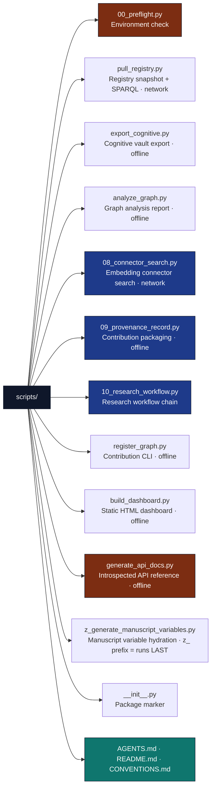

# scripts/ - Orchestration Scripts

## Overview

The `scripts/` directory contains **Thin Orchestrators**. A "Thin Orchestrator" is a script that *strictly coordinates* business logic without implementing it directly. All complex operations must reside in the thoroughly tested `src/` directory; the scripts import from `src/` and write artifacts under `output/`.

The same functionality is available through the `daf-okn` console script (also `python -m daf_okn`) with subcommands `pull` (`list`, `snapshot`, `query`), `analyze`, `bundle-rdf`, `export`, `explain-join`, `join`, `package`, `status`, and `visualize`.

## Key Concepts

- **Thin Orchestrator Pattern**: Scripts act as glue. They compose functions from `src/`, coordinate pipeline stages, and write `output/` artifacts — never graph logic, metric math, or RDF serialization themselves.
- **Self-contained**: each script depends only on `src/daf_okn` and the declared project dependencies.
- **Alphabetical ordering hints (`y_*`, `z_*`)**: scripts whose filenames start with a letter prefix run **after** any plainly-named script (alphabetical order). `z_generate_manuscript_variables.py` consumes `output/data/graph_report.json` and `manuscript/config.yaml` and writes the `{{TOKEN}}` map to `output/data/manuscript_variables.json` — so it must run after analysis. The alphabetical prefix is a human-readable hint for manual invocation; there is no pipeline runner, so run the scripts in the order you need.
- **`z_generate_manuscript_variables.py` strict mode**: default invocation calls `generate_variables(..., require_analysis_outputs=True)` and fails with `FileNotFoundError` when `output/data/graph_report.json` is absent. Use `--allow-draft` for early manuscript drafts that intentionally use `"N/A"` sentinels.

## Directory Structure



## Installation/Setup

Scripts require the project dependencies:

- `yaml`, `requests`, `networkx`, `rdflib`, `matplotlib` — registry, graph, RDF, and figure operations
- `numpy` — metric computations

## Usage Examples

### Running the Research Workflow

```bash
uv run python scripts/10_research_workflow.py --cognitive-repo <vault>
```

This script chains, in-process:

1. **Pull registry** — snapshot the OKN catalog (45 graphs) to `output/data/registry_snapshot.yaml`
2. **Export cognitive KB** — vault → `output/data/cognitive_kg.json` (skipped when no repo/graph configured)
3. **Analyze graph** — → `output/data/graph_report.json` (skipped when no graph)
4. **Visualize** — `output/figures/registry_catalog.png` + `output/figures/cognitive_network.png`

The repo path comes from `--cognitive-repo` or `$DAF_OKN_COGNITIVE_REPO`. Stages 2–3 are skipped by design when unconfigured; stage 1 and the connector search are the network-dependent stages.

### Manual Script Execution

```python
import sys
from pathlib import Path

# Add project paths
project_root = Path(__file__).parent.parent
sys.path.insert(0, str(project_root / "src"))

# Import and run analysis
from analyze_graph import main
main()
```

## Configuration

Scripts read their parameters from project sources, not hardcoded grids:

- **Registry catalog**: `kgs.yaml` (45 graph entries: shortname, title, description, sparql, tpf, stats, funding, contact, frink-options); `--kgs-path` reads a local snapshot offline
- **Cognitive repo**: `--cognitive-repo` / `$DAF_OKN_COGNITIVE_REPO`
- **Manuscript parameters**: `manuscript/config.yaml` (parsed by `00_preflight.py` and consumed by variable hydration)
- **Output directories**: `output/data/`, `output/figures/`, `output/web/`, `output/docs/`, `output/data/provenance/`

## Testing

Scripts are tested through the project test suite:

```bash
# Run all project tests (includes script smoke tests)
uv run pytest ../tests/ -v

# Script smoke tests
uv run pytest ../tests/analysis/test_scripts_smoke.py -v
```

Smoke tests invoke real commands and assert real output files appear. See [`testing_philosophy.md`](../docs/testing_philosophy.md).

## API Reference

### 00_preflight.py

Environment check: Python ≥ 3.10; dependency imports (`yaml`, `requests`, `networkx`, `rdflib`, `matplotlib`, `daf_okn.core.graph`, `daf_okn.core.registry`, `daf_okn.analysis.pipeline`); `manuscript/config.yaml` parses. Exits nonzero with actionable diagnostics on failure. Not pipeline-required.

### pull_registry.py

Thin wrapper → [`src/daf_okn/core/registry.py`](../src/daf_okn/core/registry.py). Lists graphs, saves a `kgs.yaml` snapshot, and runs per-graph or federation SPARQL queries. `--kgs-path` runs offline from a local snapshot. Raises `RegistryError` on HTTP ≥ 400 or malformed responses.

### export_cognitive.py

Thin wrapper → [`src/daf_okn/core/cognitive_adapter.py`](../src/daf_okn/core/cognitive_adapter.py). Parses an Obsidian vault (frontmatter, wiki links, semantic relations) and exports `output/data/cognitive_kg.json`. Flags: `--repo` / `$DAF_OKN_COGNITIVE_REPO`, `--keep-redirects`, `--no-wikilinks`.

### analyze_graph.py

Thin wrapper → [`src/daf_okn/analysis/pipeline.py`](../src/daf_okn/analysis/pipeline.py). Loads a GraphDocument JSON, runs `run_analysis()`, writes `graph_report.json` (`--out-dir` defaults to `output/analysis`).

### 10_research_workflow.py

Opt-in research-workflow chain: `pull_registry` → `export_cognitive` → `analyze_graph` → `visualize`, in-process. Writes `registry_snapshot.yaml`, `cognitive_kg.json`, `graph_report.json`, and both figure PNGs. Stages 2–3 are skipped by design when no cognitive repo/graph is configured (`--cognitive-repo` / `$DAF_OKN_COGNITIVE_REPO` / `--graph`).

### 08_connector_search.py

Enumerates the registry graph list via `OKNRegistry`, then runs `manuscript/config.yaml` keywords through the embeddings service (`POST https://apps.okn.us/embeddings/query`) → `output/data/connector_search/results.json`. Needs network. Flags: `--kgs-path`, `--keywords`, `--limit`, `--out`.

### 09_provenance_record.py

Loads a GraphDocument JSON, runs [`core/contribute.py`](../src/daf_okn/core/contribute.py)::`validate_package` → writes `output/data/provenance/package/{name}.nq`, `registry/docs/registry/kgs/{shortname}.md`, `checklist.md`, and records `output/data/provenance/provenance_record.json` (problems + per-artifact SHA-256). Exits 1 if problems. Offline.

### register_graph.py

Thin wrapper for [`core/contribute.py`](../src/daf_okn/core/contribute.py)::`main` — contribution packaging CLI. Contribution RDF uses SKOS, DCTERMS, and schema.org terms with entity IRIs under `https://purl.org/okn/frink/kg/<graph name>/` and named graph `https://purl.org/okn/frink/kg/<graph name>`; registry entries are written to `<out>/registry/docs/registry/kgs/<shortname>.md`.

### build_dashboard.py

Thin wrapper → [`src/daf_okn/dashboard/`](../src/daf_okn/dashboard/). Builds the static dashboard HTML from a graph JSON → `output/web/dashboard.html`.

### generate_api_docs.py

Thin wrapper delegating to [`src/daf_okn/core/documentation.py`](../src/daf_okn/core/documentation.py)::`build_api_reference_markdown()` — introspects the real modules (no static template) and writes `output/docs/api_reference.md`.

### z_generate_manuscript_variables.py

Thin wrapper → [`src/daf_okn/core/manuscript_variables.py`](../src/daf_okn/core/manuscript_variables.py). Calls `generate_variables()` + `save_variables()` → `output/data/manuscript_variables.json`. It also calls `write_resolved_manuscript()` to write token-substituted copies of the chapters to `output/manuscript/`; it does not render a PDF. `--allow-draft` flag for `"N/A"` sentinels.

## Error Handling Patterns

Comprehensive error handling with recovery suggestions:

```python
try:
    report = run_analysis(graph, out_dir=data_dir)
except FileNotFoundError as e:
    logger.error(f"Missing analysis output: {e}")
    logger.info("Recovery: run scripts/analyze_graph.py first, or use --allow-draft")
    sys.exit(1)
except RegistryError as e:
    logger.warning(f"Registry unavailable, recording skip: {e}")
```

- `RegistryError` (HTTP ≥ 400 / malformed) → record the skip; network stages are opt-in boundaries
- `FileNotFoundError` (missing `graph_report.json` in strict hydration) → recover by running analysis or `--allow-draft`

## Troubleshooting

### Common Issues

- **Import errors**: Ensure script is run from project root directory
- **Path issues**: Scripts assume standard project directory structure
- **Network failures**: `RegistryError`/connection errors on pull/connector stages — work offline from a `--kgs-path` snapshot
- **Missing outputs**: Stage-skips (no cognitive repo configured) are recorded by design, not failures

### Debug Tips

Add debug output to scripts:

```python
import logging
logging.basicConfig(level=logging.DEBUG)
```

## Best Practices

- **Path handling**: Use `pathlib.Path` and `core/project_paths.py` for cross-platform compatibility
- **Error handling**: Scripts should fail with an actionable message when inputs are missing
- **Output validation**: Verify generated files exist and have content
- **Reproducibility**: Use fixed inputs and the same `kgs.yaml` snapshot across runs

## See Also

- [README.md](README.md) - Quick reference
- [CONVENTIONS.md](CONVENTIONS.md) - Orchestration rules
- [../src/daf_okn/core/registry.py](../src/daf_okn/core/registry.py) - Registry client used by scripts
