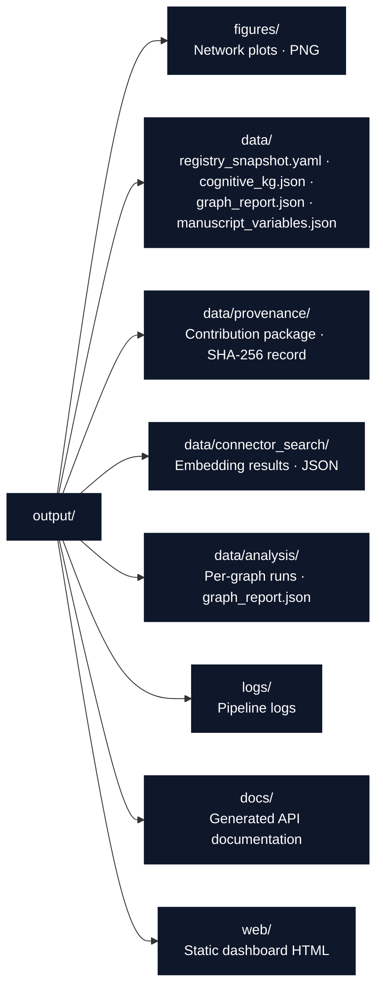

# Script Conventions

Orchestration rules and integration patterns for `scripts/` in the `daf_okn` project.

## Thin Orchestrator Rules

Scripts **coordinate** — they never **compute**:

```python
# Correct: Script imports and orchestrates
from daf_okn.core.graph import load_json
from daf_okn.analysis.pipeline import run_analysis

report = run_analysis(load_json(args.graph), out_dir=args.out_dir)
print(report["report_path"])
```

```python
# Wrong: Script implements logic directly
def density(edge_count, node_count):
    return 2 * edge_count / (node_count * (node_count - 1))  # Metrics belong in src/
```

If you find yourself computing graph behavior in `scripts/`, move it to
`src/` first.

## Import Patterns

```python
import sys
from pathlib import Path

# 1. Standard library imports
import argparse
import json

# 2. Third-party imports
import networkx as nx
import yaml

# 3. Project source imports (scripts may add src/ to sys.path)
from daf_okn.core.graph import load_json
from daf_okn.analysis.pipeline import run_analysis
```

- Use explicit imports (not `from module import *`)

## Output Directory Structure

Scripts must write to the standard output layout:



```python
# Standard output path setup
from daf_okn.core.project_paths import resolve_project_root, project_output_dirs

root = resolve_project_root()
dirs = project_output_dirs(root)   # canonical output/ subdirectories
```

## Error Handling with Recovery

```python
try:
    report = run_analysis(graph, out_dir=data_dir)
except FileNotFoundError as e:
    logger.error(f"Analysis failed: {e}")
    logger.info("Recovery: run scripts/analyze_graph.py first, or pass --allow-draft for drafts")
    sys.exit(1)
```

- Log errors with `logger.error()` (via `core/_runtime.py::get_logger`), never `print()`
- Provide actionable recovery suggestions
- Use `sys.exit(1)` for fatal errors, not bare `raise`
- Typed failures: `RegistryError` on HTTP ≥ 400/malformed registry responses;
  `FileNotFoundError` for missing analysis outputs in strict mode

## Progress and Long-Running Stages

Network stages (registry pull, connector search, embeddings) can be slow and
may fail. Skip cleanly and record the skip — a deliberate boundary, not a
silent success:

```python
try:
    snapshot = registry.list_graphs()
except RegistryError as e:
    logger.warning(f"Registry unavailable, skipping stage 1: {e}")
    return  # record the skip in the workflow summary
```

## Orchestration Checklist

Before submitting a new or modified script, verify:

- [ ] All logic lives in `src/`, not in the script
- [ ] Imports only `src/daf_okn` and declared project dependencies
- [ ] Logs with `get_logger(__name__)` (not `print()`)
- [ ] Writes output to standard `output/` subdirectories with fixed, predictable filenames
- [ ] Uses `Path` objects and `core/project_paths.py` (not string concatenation) for file paths
- [ ] Handles network failure with a clean, recorded skip
- [ ] Includes error handling with recovery suggestions

## See Also

- [AGENTS.md](AGENTS.md) — Full API reference for all script functions
- [../src/STYLE.md](../src/STYLE.md) — Style guide for the code scripts import
- [../docs/architecture.md](../docs/architecture.md) — Thin orchestrator flow diagram
