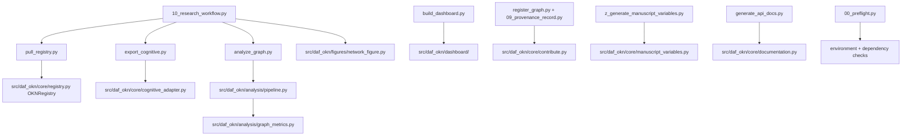

# scripts/ - Orchestration Scripts

**Thin Orchestrators** demonstrating strict integration patterns. These scripts *do not contain core logic*. They import from the `src/` directory, coordinate pipeline stages, and bridge results into `output/` artifacts. The same functionality is available through the `daf-okn` console script (also `python -m daf_okn`): `pull` (`list`, `save-snapshot`, `query`), `analyze`, `export`, `package`, `visualize`.

## Quick Start

```bash
# Environment check
uv run python scripts/00_preflight.py

# Full research workflow: registry → export → analysis → figures
uv run python scripts/10_research_workflow.py --cognitive-repo <vault>

# View generated outputs
ls -la ../output/
```

## Scripts

| Script | Purpose | Inputs | Outputs |
| --- | --- | --- | --- |
| `00_preflight.py` | Environment check (Python ≥ 3.10, deps, `config.yaml` parses) | — | actionable preflight diagnostics |
| `pull_registry.py` | List/snapshot registry catalog; per-graph/federation SPARQL | network or `--kgs-path` | `kgs.yaml` snapshot, query results |
| `export_cognitive.py` | Cognitive vault → typed graph | `--repo` / `$DAF_OKN_COGNITIVE_REPO` | `output/data/cognitive_kg.json` |
| `analyze_graph.py` | Structural metrics + report | GraphDocument JSON | `output/analysis/graph_report.json` |
| `10_research_workflow.py` | Chains pull → export → analyze → visualize in-process | `--cognitive-repo` / `--graph` | snapshot, kg JSON, report, 2 PNGs |
| `08_connector_search.py` | Keyword connector search via registry embeddings | network, `manuscript/config.yaml` keywords | `output/data/connector_search/results.json` |
| `09_provenance_record.py` | Validate + package registry contribution | GraphDocument JSON | `output/data/provenance/` (N-Quads, entry, checklist, SHA-256 record) |
| `register_graph.py` | Contribution packaging CLI (`core/contribute.main`) | GraphDocument JSON | contribution package |
| `build_dashboard.py` | Static HTML dashboard from a graph | GraphDocument JSON | `output/web/dashboard.html` |
| `generate_api_docs.py` | Introspected API reference (no static template) | `src/` modules | `output/docs/api_reference.md` |
| `z_generate_manuscript_variables.py` | Manuscript `{{TOKEN}}` map (runs after analysis; `z_` prefix) | `config.yaml` + `graph_report.json` | `output/data/manuscript_variables.json` |

Full API and smoke-test notes: [`AGENTS.md`](AGENTS.md). Conventions: [`CONVENTIONS.md`](CONVENTIONS.md).

## Architecture



## More Information

See [AGENTS.md](AGENTS.md) for technical documentation and
[CONVENTIONS.md](CONVENTIONS.md) for orchestration rules.

## Offline gate

`bash scripts/gate.sh` runs the locked local pytest suite and its 90% branch
coverage requirement. It accepts no arguments so a stack gate cannot accidentally
select a smaller test subset.

`generate_api_docs.py` and `z_generate_manuscript_variables.py` accept
`--project-root PATH`. Smoke tests use temporary roots for generated files; the
variable generator reads configuration and analysis data from that same root.
