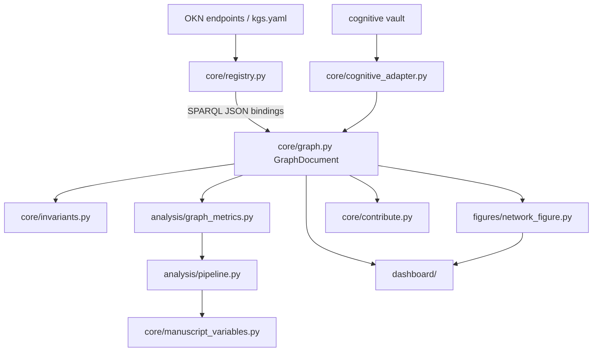

# src/ - Project Logic

OKN registry client, graph document model, structural invariants, the cognitive knowledge-base adapter, registry contribution packaging, graph metrics and the analysis pipeline, network figures, the static dashboard, and manuscript-variable extraction for daf-okn. The pure graph layer stays deterministic; generated-output workflows live in importable modules so scripts remain thin wrappers.

## Quick Start

```python
from daf_okn.core.registry import OKNRegistry
from daf_okn.core.graph import bindings_to_graph
from daf_okn.analysis.pipeline import run_analysis

registry = OKNRegistry()  # reads kgs.yaml; inject requests.Session in tests
sparql_json = registry.sparql("cognitive", "SELECT ?s ?p ?o WHERE { ?s ?p ?o }")

doc = bindings_to_graph(sparql_json, graph_name="cognitive")
report = run_analysis(doc, out_dir="output/analysis")
print(report["metrics"]["node_count"], report["metrics"]["density"])
```

## Key Features

- **Registry client** `core/registry.py`: `OKNRegistry` over `kgs.yaml` — per-graph/federation SPARQL, TPF fragments, VoID statistics, embeddings search; `RegistryError` on HTTP ≥ 400
- **Graph document model** `core/graph.py`: `NodeRecord`/`EdgeRecord`, `GraphDocument` with `to_networkx`, JSON persistence, and `bindings_to_graph` (SPARQL JSON → graph)
- **Invariants** `core/invariants.py`: `validate_graph` and `graph_stats`
- **Cognitive adapter** `core/cognitive_adapter.py`: Obsidian-vault parser → cognitive graph
- **Contribution packaging** `core/contribute.py`: `graph_to_rdf` (SKOS/DCTERMS/schema.org RDF, see `core/rdf.py`), registry entry, checklist, `validate_package`
- **Importable analysis pipeline** in `analysis/` (`graph_metrics.py`, `pipeline.py`)
- **Matplotlib figures** in `figures/network_figure.py`
- **Static HTML dashboard** in `dashboard/` (no JavaScript dependencies)
- **Manuscript `{{TOKEN}}` map** in `manuscript_variables.py`
- **API reference builder** in `documentation.py` (invoked by `scripts/generate_api_docs.py`)
- **Reproducible results** with deterministic behavior
- **Type-safe** with type hints

## Common Commands

### Import and Use

```python
from daf_okn.core.graph import GraphDocument
from daf_okn.analysis.graph_metrics import compute_metrics
from daf_okn.dashboard.dashboard_payload import build_payload

doc = GraphDocument.load_json("output/data/cognitive_kg.json")
metrics = compute_metrics(doc)
payload = build_payload(doc, metrics)
```

### Run Tests

```bash
uv run pytest tests/ --cov=src --cov-fail-under=90
```

## Architecture



## More Information

See [AGENTS.md](daf_okn/AGENTS.md) for technical documentation.
