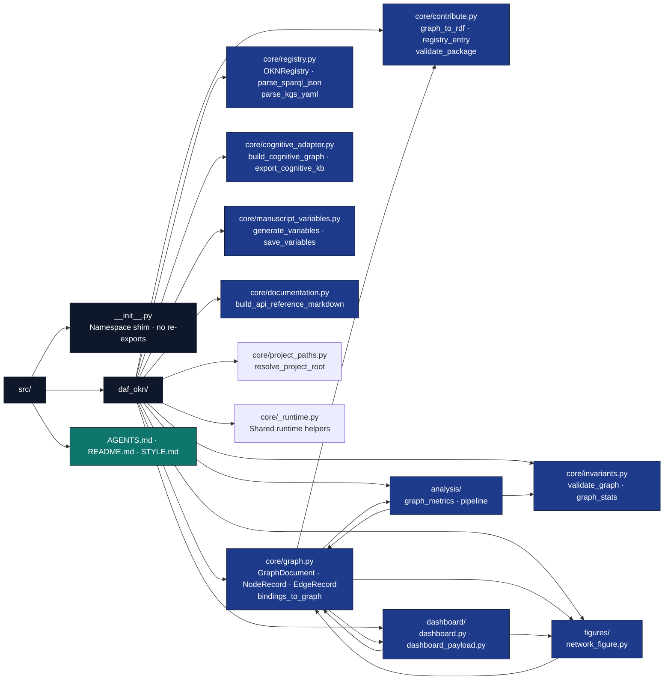

# src/daf_okn/ - Project Logic

## Overview

The `src/` directory contains the importable project logic for the daf-okn project. The package lives at `src/daf_okn/`, with the pure graph layer (`core/graph.py`, `core/invariants.py`, `core/registry.py` parsing helpers) deterministic and network-free at import; generated-output workflows (`analysis/`, `figures/`, `dashboard/`, `core/manuscript_variables.py`, `core/documentation.py`) live in the package so scripts stay thin CLI wrappers. The shared in-memory contract is the `GraphDocument` model in `core/graph.py`; every other module reads or produces graph documents.

## Key Concepts

- **Graph document model**: `core/graph.py` is the single source of truth for nodes (`NodeRecord`), edges (`EdgeRecord`), and the named `GraphDocument` collection with `to_networkx` / `to_dict` / `from_dict` / `save_json` / `load_json` and the SPARQL-JSON converter `bindings_to_graph`.
- **Pure scientific core**: `core/graph.py`, `core/invariants.py`, `core/cognitive_adapter.py`, and the parsing half of `core/registry.py` are side-effect-free. They take inputs and return outputs.
- **Network at the edges**: `OKNRegistry` performs HTTP I/O only inside methods (per-graph/federation SPARQL, TPF, VoID, embeddings); no I/O happens at import, and tests inject a `requests.Session`.
- **Importable project workflows**: `analysis/`, `figures/`, `dashboard/`, and the manuscript-variable/API-reference builders may perform explicit file I/O, but scripts should only delegate to them.
- **Stack roster consumer**: `core/stack_roster.py` reads the JSON printed by
  `daf-stack-doctor roster` and compares one member entry (path, branch, required
  files, gate command, board, Sidecar manifest) against this checkout. It runs no
  command, writes nothing and reports `native_gate: not_run`.
- **Zero-mock testability**: pure functions are tested exhaustively with real data; workflow modules are tested through real temp files, subprocesses, and generated artifacts.
- **Type safety** with comprehensive type hints and Google-style docstrings.

## Directory Structure



## Installation/Setup

This module uses standard scientific Python libraries (pinned in [`pyproject.toml`](../../pyproject.toml)):

- `networkx` - graph model projections and structural metrics
- `matplotlib` - network and catalog figures (Agg backend)
- `requests` - OKN registry HTTP client
- `rdflib` - RDF/N-Quads contribution packaging
- `pyyaml` - registry snapshot and config parsing

## Dependency Rules

The graph core is network-free at import and has no dependency on the scripts or the manuscript: `core/graph.py` and `core/invariants.py` are pure functions over `GraphDocument`. `analysis/`, `figures/`, and `dashboard/` build on `core/` and may write files when asked; `scripts/` only wraps them. Logging uses the standard library (`core/_runtime.py::get_logger`).

## Usage Examples

### Build and analyze a graph

```python
from daf_okn.core.graph import GraphDocument, bindings_to_graph
from daf_okn.core.invariants import validate_graph, graph_stats
from daf_okn.analysis.pipeline import run_analysis

doc = bindings_to_graph(sparql_json, graph_name="cognitive")
problems = validate_graph(doc)          # [] when the document is well-formed
report = run_analysis(doc, out_dir="output/analysis")
print(report["metrics"]["node_count"], report["metrics"]["density"])
```

### Query the registry

```python
from daf_okn.core.registry import OKNRegistry

registry = OKNRegistry()                # reads kgs.yaml; inject requests.Session in tests
graphs = registry.list_graphs()
rows = registry.sparql_rows("cognitive", "SELECT ?s ?p ?o WHERE { ?s ?p ?o } LIMIT 10")
```

### Export and contribute

```python
from pathlib import Path
from daf_okn.core.cognitive_adapter import export_cognitive_kb
from daf_okn.core.contribute import graph_to_rdf, validate_package

doc = export_cognitive_kb(Path("cognitive/"), Path("output/data/cognitive_kg.json"))
graph_to_rdf(doc, Path("output/data/cognitive-kb.nq"))
issues = validate_package(doc, Path("output/data/provenance/package"))
```

## Testing

```bash
# Run all tests for this module
uv run pytest tests/ -v

# Run one cluster
uv run pytest tests/core/ -v

# Run with coverage (gate enforced by pyproject.toml)
uv run pytest tests/ --cov=src --cov-fail-under=90
```

## API Reference

### core/graph.py

#### GraphDocument (dataclass)

Named collection of `NodeRecord`s and `EdgeRecord`s plus metadata. Methods:
`validate()` (delegates to `core/invariants.py` rules), `to_networkx(directed=True)`,
`to_dict()` / `from_dict()`, `save_json(path)` / `load_json(path)`.

#### bindings_to_graph (function)

```python
def bindings_to_graph(sparql_json: dict[str, Any], graph_name: str) -> GraphDocument:
    """Convert a SPARQL 1.1 JSON result (head.vars / results.bindings) into a GraphDocument."""
```

### core/registry.py

#### OKNRegistry (class)

Client for the OKN registry and query services. Facts sourced from
`docs/okn/api-notes.md`. Constants: `KGS_YAML_URL`, `PER_GRAPH_SPARQL_TEMPLATE`,
`TPF_TEMPLATE`, `EMBEDDINGS_QUERY`, `NAMED_GRAPH_TEMPLATE`, `DEFAULT_TIMEOUT`.

- `list_graphs(kgs_path=None)` — parse the `kgs.yaml` catalog into snapshot dicts
- `get_graph(shortname)` — single catalog entry
- `sparql(...)` / `sparql_rows(...)` — per-graph and federation SPARQL (`void=True` for VoID statistics)
- `tpf(...)` — per-graph Triple Pattern Fragments (Trig)
- `embedding_search(...)` — embeddings JSON API (POST-only)
- Raises `RegistryError` on HTTP ≥ 400 or malformed payloads; accepts an injected `requests.Session`

Helpers: `parse_sparql_json(payload)`, `parse_kgs_yaml(raw)`, `local_name(iri)`,
`named_graph_iri(shortname)`.

### core/invariants.py

- `validate_graph(doc: GraphDocument) -> list[str]` — duplicate node ids, edge
  endpoints missing from the node set, self-loops, empty node ids.
- `graph_stats(doc: GraphDocument) -> dict[str, Any]` — node/edge counts, density,
  directedness, weakly-connected component count.

Both are pure functions over the document; no I/O, no network access.

### core/cognitive_adapter.py

Ports the Active Inference Institute `cognitive` markdown vault into the shared
graph model (parsing rules re-implemented from the upstream repository; no code
imported from it).

- `parse_frontmatter(text)` — YAML frontmatter split
- `parse_semantic_relations(links)` — `semanticRelations` dialect → (source, target) pairs
- `extract_wiki_links(text)` — `[[wiki links]]` outside code fences/matrices
- `build_cognitive_graph(...)` — vault directory → `GraphDocument` (wiki-target
  resolution order, alias redirects, frontmatter attributes)
- `export_cognitive_kb(repo_root, out_path, **opts)` — build + persist JSON; returns the document

### core/contribute.py

Registry contribution packaging (workflow facts documented in `docs/okn/contribute.md`
and `docs/okn/api-notes.md`):

- `graph_to_rdf(doc, ...)` (implemented in `core/rdf.py`, re-exported) — RDF using SKOS, DCTERMS, and schema.org terms; entity IRIs live under `https://purl.org/okn/frink/kg/<shortname>/` and the named graph is `https://purl.org/okn/frink/kg/<shortname>`; relations no standard term covers become `<base>relation/<name>` sub-properties of `skos:semanticRelation`; other attributes go under `<base>vocab/`; N-Triples/N-Quads output is sorted and byte-stable
- `registry_entry(...)` — markdown entry whose frontmatter is exactly `template`, `shortname`, `title`, `description`, `stats`, `homepage`, `funding` (only if supplied), `frink-options`, `contacts`; never `sparql`/`tpf`; written to `registry/docs/registry/kgs/<shortname>.md` inside the package
- `contribution_checklist()` / `upload_commands(...)` — documented upload steps
- `validate_package(doc, out_dir)` — writes `<shortname>.<fmt>`, the registry entry and `checklist.md`, and returns problems (empty graph name, bad shortname, missing contacts/homepage/description, non-IRI-safe ids)
- `PRESET_ENTRIES` — ready-made entry inputs (`cognitive-kb`), selected with `--preset`
- `main(argv)` — CLI used by `scripts/register_graph.py`

### core/manuscript_variables.py

#### generate_variables (function)

```python
def generate_variables(config_path: Path, *, require_analysis_outputs: bool = True) -> dict[str, str]:
    """Build the flat ``UPPERCASE_KEY -> value`` map for ``{{TOKEN}}`` injection.

    Reads manuscript/config.yaml (CONFIG_* tokens) and output/data/graph_report.json
    (graph-metric tokens). Pipeline mode (default) raises FileNotFoundError when the
    report is missing; --allow-draft substitutes explicit "N/A" sentinels.
    """
```

#### save_variables (function)

```python
def save_variables(variables: dict[str, str], output_path: Path) -> Path:
    """Write manuscript_variables.json for rendering and debugging."""
```

### core/documentation.py

`build_api_reference_markdown()` imports each module listed in `_DOCUMENTED_MODULES`
and renders its public API (per the module's `__all__`) with live `inspect` signatures
and first docstring lines. Invoked by `scripts/generate_api_docs.py`; there is no
hand-maintained template, so the reference cannot drift from the code.

### core/project_paths.py

- `resolve_project_root(package_name)` — resolves the project root from the caller's
  module (falls back to the package's own root)
- `project_root_context(project_root)` — context manager override (tests use this)
- `project_output_dirs(project_root=None)` — standard `output/{figures,data,reports,web,docs}` map

### core/_runtime.py

Shared runtime helpers for `src/` modules: `project_root(caller)`, `get_logger`,
`save_figure_data`.

### analysis/ package

- `graph_metrics.py` — pure NetworkX metrics: `degree_sequence`, `in_out_degrees`,
  `centrality_scores`, `edge_centrality_scores`, `component_counts`, `triangle_count`,
  and the one-call summary `compute_metrics` (counts, density, connectivity, mean
  degree, triangles, centralities, top central nodes).
- `pipeline.py` — `run_analysis(graph, out_dir) -> dict` measures a `GraphDocument`,
  writes `graph_report.json` (`REPORT_FILENAME`), and returns the report as a dict.
  CLI lives in `../../scripts/analyze_graph.py` (thin wrapper).

### figures/ package

- `network_figure.py` — `plot_network` (spring/circular/kamada_kawai/random layouts,
  degree-scaled nodes, top-N degree labels, directed edge arrows),
  `plot_graph_catalog` (bar chart of registry graph shortnames counting metadata
  fields), `network_figure_bytes` (PNG bytes for dashboard data-URI embedding).
- `figures/__init__.py` — re-export barrel (`from daf_okn.figures import plot_network, ...`).

### dashboard/ package

- `dashboard_payload.py` — `build_payload(doc, metrics=None)`: pure, JSON-serializable
  summary (graph stats or provided metrics) plus node/edge tables capped at
  `MAX_TABLE_ROWS`.
- `dashboard.py` — `build_dashboard(doc, metrics, out_path, *, title=...)` writes the
  static, dependency-free HTML page (summary stats, capped tables, data-URI network
  figure, links to okn.us and registry.okn.us); `cli_main(argv)` is the CLI entry.
- CLI in `../../scripts/build_dashboard.py`.

## Configuration

The package reads no experiment configuration: graph data comes from the registry
pull (`kgs.yaml` snapshot) or exported knowledge-base JSON. Manuscript tokens are
listed in the `variables:` block of [`manuscript/config.yaml`](../../manuscript/config.yaml)
and produced by `core/manuscript_variables.py::generate_variables()`.

## Troubleshooting

### Common Issues

- **`RegistryError`**: HTTP ≥ 400 or malformed responses from OKN endpoints — check
  network access and the `kgs.yaml` snapshot (`docs/okn/api-notes.md` documents endpoints)
- **`FileNotFoundError` on `graph_report.json`**: run `scripts/analyze_graph.py` (or
  `scripts/10_research_workflow.py`) before manuscript-variable hydration, or pass `--allow-draft`
- **Dangling edges in a graph document**: `validate_graph()` lists each problem; fix
  the producing parser, not the derived artifacts

### Debug Tips

Import the module directly and exercise it on real fixtures — the suite in
`tests/` demonstrates every workflow boundary with real files, not mocks.

## Best Practices

- Validate graph invariants (`core/invariants.py::validate_graph`) before writing
  derived artifacts
- Keep network access at the edges: `OKNRegistry` performs I/O on request, never at import
- Keep `core/` free of script-level concerns; scripts stay thin wrappers over `src/`
- Take a `GraphDocument` (or `networkx` projection) as input whenever a new helper
  needs graph data — do not invent a second graph representation

## See Also

- [README.md](README.md) - Quick reference
- [STYLE.md](../STYLE.md) - Code style for this layer
- [../../scripts/README.md](../../scripts/README.md) - CLI entry points
- [../../tests/README.md](../../tests/README.md) - Zero-mock test suite
