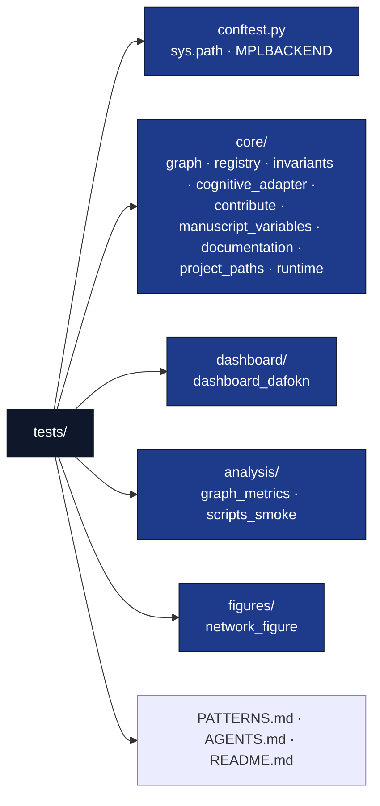

# tests/ - Test Suite

## Overview

The `tests/` directory contains tests for the OKN graph tooling in `src/daf_okn/`. These tests validate correctness, structural invariants, and edge case handling without using mocks - all tests use real data and real files. Orchestration modules may use `pytest.MonkeyPatch` on module attributes per [`PATTERNS.md`](PATTERNS.md).

## Key Concepts

- **Real data testing**: No mocks; tests build real `GraphDocument` fixtures, parse real vault/vault-dialect markdown, and write real temp files
- **Structural accuracy**: Tests verify graph round-trips, metric values, and invariant outcomes
- **Edge case coverage**: Tests handle boundary conditions and error cases (`RegistryError`, dangling edges, unknown layouts)
- **Deterministic results**: Prefer fixed inputs; document or bound any random draws (see Best Practices)

## Directory Structure



Tests require the same dependencies as the main code:

- `networkx` - graph projections
- `requests` / `rdflib` - registry and RDF paths
- `matplotlib` - figure tests (Agg backend pinned in `conftest.py`)
- `pytest` - test framework

## Usage Examples

### Run All Tests

```bash
# From project root
uv run pytest tests/

# With verbose output
uv run pytest tests/ -v

# With coverage (gate enforced by pyproject.toml)
uv run pytest tests/ --cov=src --cov-fail-under=90
```

### Run Specific Test Classes

```bash
# Graph model round-trips
uv run pytest tests/ -k "TestGraphDocumentDict"

# Registry client behavior
uv run pytest tests/ -k "TestOKNRegistrySparql"

# Structural metrics
uv run pytest tests/ -k "TestComputeMetrics"
```

### Debug Individual Tests

```bash
# Run single test with debug output
uv run pytest tests/core/test_graph.py::TestBindingsToGraph -v -s
```

## Configuration

Tests use fixed fixtures for consistency:

- **Graph fixtures**: small, hand-built `GraphDocument`s with known node/edge counts
- **HTTP tests**: `requests.Session` injected with stubbed transports — no network
- **Tolerances**: `atol=1e-4`, `rtol=1e-6` for floating-point metric comparisons
- **Random draws**: Rare; where used (e.g. layout seeds), seed explicitly and keep assertions structural

## Testing Philosophy

### Zero-Mock Policy

All tests in this project enforce a strict **Zero-Mock Policy**. Validation uses real algorithms and data paths — no mocked objects or faked side-effects. Coverage expectations are enforced via `pyproject.toml`.

- ✅ **Structural correctness**: Tests verify actual graph behavior
- **Integration validation**: Tests validate module pipelines end to end
- ✅ **Metric accuracy**: Tests check counts, density, and centrality values
- ❌ **No mock objects**: Every test exercises real code paths

### Test Categories

#### Core model and parsing tests (`tests/core/`)

1. **test_graph.py** — `NodeRecord`/`EdgeRecord` defaults, `GraphDocument`
   dict/JSON round-trips, `to_networkx`, `bindings_to_graph` role resolution
2. **test_registry.py** — SPARQL JSON parsing, `kgs.yaml` parsing, `OKNRegistry`
   sparql/rows/tpf/embeddings with injected sessions, `RegistryError` paths,
   session laziness (no I/O at import)
3. **test_invariants.py** — duplicate ids, dangling endpoints, self-loops,
   `graph_stats` values
4. **test_cognitive_adapter.py** — frontmatter, wiki links, semantic relations,
   redirect handling, vault → graph building
5. **test_rdf.py / test_contribute.py** — SKOS/DCTERMS/schema.org mapping, RDF
   round trips and determinism, registry entry fields, checklist, `validate_package`
   (plus `tests/cli/test_cli.py` for the `daf-okn` command line and
   `core/test_project_metadata.py` for version and public-readiness checks)
6. **test_manuscript_variables.py** — token map from config + `graph_report.json`,
   `--allow-draft` sentinels, live manuscript token cross-reference
7. **test_documentation.py / test_project_paths.py / test_runtime.py** — API
   reference builder, path resolution, runtime helpers
8. **test_stack_roster.py** — `daf-stack` roster shape parsing, branch/file/
   gate/board/Sidecar membership checks, and this checkout against the
   requirements the stack manifest declares for it

#### Metric and orchestration tests (`tests/analysis/`, `tests/figures/`, `tests/dashboard/`)

- `test_graph_metrics.py` — `compute_metrics` values and helper functions
- `test_scripts_smoke.py` — subprocess smoke for `generate_api_docs.py` and `00_preflight.py`
- `test_network_figure.py` — PNG output validity, determinism, unknown-layout errors
- `test_dashboard_dafokn.py` — payload keys/round-trip, capped tables, static HTML CLI

## Troubleshooting

### Common Issues

- **Import errors**: Ensure pytest is run from the project root (`tests/conftest.py`
  adds `src/` to `sys.path` and pins `MPLBACKEND=Agg`)
- **Coverage issues**: Verify all code paths are exercised
- **Collect errors on a cold clone**: install the package and dev extras first
  (`uv sync` or `pip install -e '.[dev]'`); `conftest.py` adds `src/` to `sys.path`

### Debug Tips

Enable detailed test output:

```bash
uv run pytest tests/ -v -s --tb=long
```

Check test coverage:

```bash
uv run pytest tests/ --cov=src --cov-report=term-missing
```

## Best Practices

- **Deterministic tests**: Prefer fixed inputs; if random layout seeds are used, do not assert pixel-exact results
- **Structural assertions**: Use tolerances for floating-point metric comparisons
- **Comprehensive coverage**: Test all code paths including error conditions
- **Clear assertions**: Use descriptive assertion messages
- **Independent tests**: Each test should be runnable in isolation

## Performance Testing

Tests validate performance characteristics only through bounds:

- **Figure generation**: asserts a valid PNG and deterministic bytes, never wall-clock timings
- **Metric computation**: linear-size fixtures keep the suite fast

## See Also

- [README.md](README.md) - Quick reference
- [PATTERNS.md](PATTERNS.md) - Zero-mock patterns and fixtures
- [../src/daf_okn/core/graph.py](../src/daf_okn/core/graph.py) - Graph model under test
- [../docs/testing_philosophy.md](../docs/testing_philosophy.md) - Zero-mock rationale
