# tests/ - Zero-Mock Test Suite

An uncompromising validation layer for the OKN graph tooling in `src/daf_okn/`. Enforces a strict Zero-Mock policy.

## Quick Start

```bash
uv run pytest tests/ -v
uv run pytest tests/ --cov=src --cov-fail-under=90
```

## Key Features

- **Real data testing** (no mocks)
- **Graph-model accuracy validation** (round-trips, persistence, NetworkX projections)
- **Integration tests** for analysis, figures, dashboard, and manuscript variables
- **Deterministic results**

All test files live in cluster subdirectories mirroring
`src/daf_okn/` (`core/`, `dashboard/`, `analysis/`,
`figures/`) per SUBMODULAR-CODE-2.

| File | Focus |
| --- | --- |
| `core/test_graph.py` | `GraphDocument` model: records, dict/JSON round-trips, NetworkX projection, SPARQL bindings |
| `core/test_registry.py` | `OKNRegistry` parsing/queries with injected `requests.Session` |
| `core/test_invariants.py` | `validate_graph` / `graph_stats` |
| `core/test_cognitive_adapter.py` | Vault dialect parsing and graph building |
| `core/test_rdf.py` | Standard-vocabulary RDF: vocabulary mapping, round trips, determinism |
| `core/test_contribute.py` | Registry entry fields, contribution package, `package` CLI |
| `core/test_project_metadata.py` | One version across metadata files; nothing machine-specific shipped |
| `cli/test_cli.py` | The `daf-okn` command line, run against real files in `tmp_path` |
| `core/test_manuscript_variables.py` | `{{TOKEN}}` map + live manuscript cross-reference |
| `core/test_documentation.py` | `core/documentation.py` API reference helpers |
| `core/test_project_paths.py` | `resolve_project_root` and path overrides |
| `core/test_runtime.py` | `core/_runtime.py` helpers (logger, figure-data persistence) |
| `core/test_stack_roster.py` | `daf-stack` roster parsing and offline membership checks |
| `analysis/test_graph_metrics.py` | `compute_metrics` and metric helpers |
| `analysis/test_scripts_smoke.py` | Subprocess smoke for auxiliary scripts (`generate_api_docs.py`, `00_preflight.py`) |
| `figures/test_network_figure.py` | Deterministic PNG figure builders |
| `dashboard/test_dashboard_dafokn.py` | Dashboard payload + static HTML CLI end to end |

## Architecture

```mermaid
graph TD
    G[test_graph.py] --> GM[src/daf_okn/core/graph.py]
    R[test_registry.py] --> REG[src/daf_okn/core/registry.py]
    INV[test_invariants.py] --> INVM[src/daf_okn/core/invariants.py]
    COG[test_cognitive_adapter.py] --> CA[src/daf_okn/core/cognitive_adapter.py]
    CONTRIB[test_contribute.py] --> C[src/daf_okn/core/contribute.py]
    MV[test_manuscript_variables.py] --> VARS[src/daf_okn/core/manuscript_variables.py]
    DOC[test_documentation.py] --> D[src/daf_okn/core/documentation.py]
    PP[test_project_paths.py] --> PP[src/daf_okn/core/project_paths.py]
    RT[test_runtime.py] --> RUN[src/daf_okn/core/_runtime.py]
    MET[test_graph_metrics.py] --> ANA[src/daf_okn/analysis/]
    FIG[test_network_figure.py] --> FIGS[src/daf_okn/figures/network_figure.py]
    DASH[test_dashboard_dafokn.py] --> DB[src/daf_okn/dashboard/]
    SMK[test_scripts_smoke.py] --> SCRIPTS[scripts/ auxiliary]
    RST[test_stack_roster.py] --> SR[src/daf_okn/core/stack_roster.py]
```



> **Zero-Mock Policy**: Tests use real graph fixtures, temp files, and generated artifacts. No `unittest.mock`, `MagicMock`, or `@patch`. Orchestration modules may use `pytest.MonkeyPatch` on module attributes and subprocess import isolation — see [`PATTERNS.md`](PATTERNS.md).

## More Information

See [AGENTS.md](AGENTS.md) for technical documentation.
